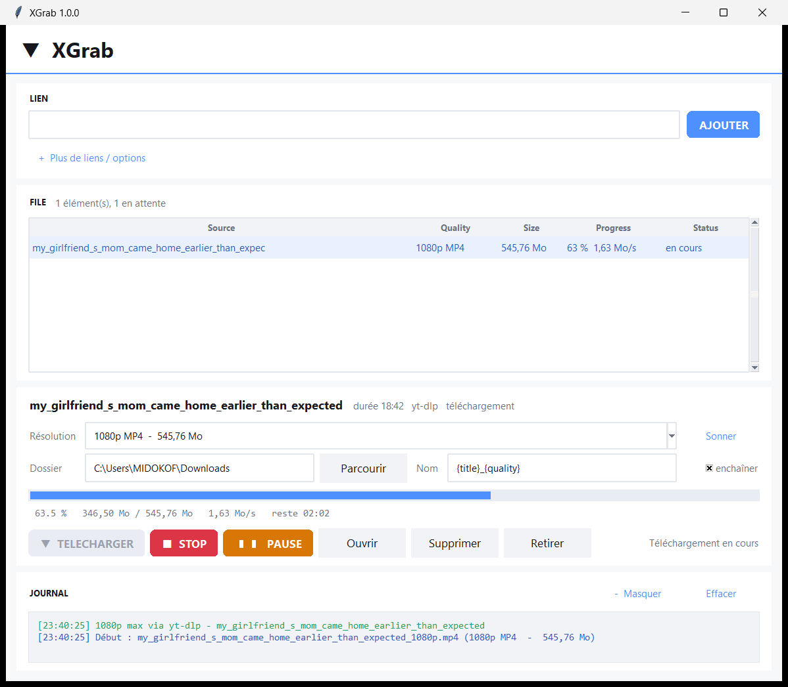

# XGrab

Téléchargeur de vidéos X / Twitter pour Windows. Résolution choisie manuellement, file d'attente, reprise de téléchargement.



## Lancer

| | |
|---|---|
| Executable | `dist\XGrab\XGrab.exe` |
| Depuis les sources | `python main.py` |
| Avec un lien pré-rempli | `python main.py "https://x.com/xxx/status/123"` |

`yt-dlp.exe` est livré à côté de l'executable. `ffmpeg` est embarqué (via `imageio-ffmpeg`) pour les flux HLS.

## Utilisation

1. Colle le lien dans la barre **LIEN** et appuie sur **Entrée** (ou **AJOUTER**)
2. La file affiche toutes les qualités disponibles
3. Choisis la résolution dans **Résolution**
4. **▼ TELECHARGER**

| Bouton | Rôle |
|---|---|
| **▼ TELECHARGER** | lance le téléchargement de la ligne sélectionnée |
| **■ STOP** | arrête le téléchargement en cours, le `.part` est conservé pour reprendre |
| **❚❚ PAUSE** | met en pause sans perdre le `.part`, **▶ REPRENDRE** repart au même octet |
| **Ouvrir** | ouvre le fichier téléchargé |
| **Ouvrir le dossier** | ouvre le dossier de destination |
| **Supprimer** | supprime le fichier (ou le `.part`) du disque, avec confirmation |
| **Retirer** | enlève la ligne de la file |
| **Sonner** | recalcule les tailles |
| Clic droit sur une ligne | même menu, directement sur la ligne visée |

Le bouton **+ Plus de liens** ouvre une zone pour coller plusieurs liens d'un coup

## Bouton sur la vidéo - intégration navigateur

Comme Internet Download Manager, un bouton **↓ XGrab** apparaît au-dessus de chaque
vidéo détectée dans le navigateur. Un clic envoie le lien directement dans
l'application, sans copier-coller.

### Installation

```powershell
powershell -ExecutionPolicy Bypass -File .\install_extension.ps1
```

Le script détecte les navigateurs installés et copie l'extension dans
`%LOCALAPPDATA%\XGrab\extension`. Le chargement est manuel, une fois par navigateur :

| Navigateur | Marche à suivre |
|---|---|
| Chrome, Edge, Brave, Opera, Vivaldi | `chrome://extensions` (ou `edge://extensions`…) → **Mode développeur** → **Charger l'extension non empaquetée** → choisir le dossier |
| Firefox | `about:debugging#/runtime/this-firefox` → **Charger un module temporaire** → choisir `manifest.json` |

Redémarrer XGrab après l'installation : il écrit son port et son jeton dans
`config.json`, à côté du manifeste.

### Fonctionnement

```
vidéo détectée  →  bouton ↓ XGrab  →  POST /add  →  XGrab démarre le téléchargement
```

- Le serveur écoute **uniquement sur `127.0.0.1`** (jamais sur le réseau)
- Chaque requête exige un **jeton** partagé, écrit par XGrab au démarrage
- Seules les origines `chrome-extension://`, `moz-extension://` et
  `ms-browser-extension://` sont acceptées
- L'extension transmet l'**URL de la page** comme `Referer` : indispensable sur
  les CDN protégés, qui répondent 404 sans lui
- Un lien déjà résolu (`.mp4`, `.m3u8`…) passe en **téléchargement direct**, sans
  ré-analyse ; un lien de page passe par l'analyse habituelle

Si XGrab est fermé, le bouton affiche « XGrab est fermé ».

(le bouton **Tout mélanger** les ajoute tous à la file). **Entrée** dans la barre
LIEN accepte le lien du presse-papiers s'il n'y en a pas d'autre.

## Sites protégés (âge, connexion, Cloudflare)

### Capture navigateur — méthode IDM (automatique)

Au premier `HTTP 403`, XGrab **ouvre Edge ou Chrome, charge la page, déclenche la
lecture et intercepte la requête HTTP réelle** du lecteur : URL signée, 21
en-têtes, ~470 caractères de cookies. Le téléchargement rejoue exactement cette
requête. Rien n'est deviné, rien n'est copié à la main.

```
HTTP 403 - capture automatique dans le navigateur (méthode IDM)...
navigateur : msedge.exe
onglet prêt, chargement de la page...
1 requête(s) vidéo interceptée(s), 1 avec cookie
Requête interceptée : 21 en-têtes, 470 car. de cookie → relance
```

Le cycle complet analyse → 403 → capture → téléchargement prend **9 secondes**.
Le profil du navigateur est conservé dans `%APPDATA%\XGrab\browser-profile` :
connecte-toi une fois, et les sessions suivantes sont réutilisées.

Le bouton **Capturer** dans **+ Plus de liens / options** permet de déclencher
la même chose à la main, avant même de tenter un téléchargement.

### Vérification

| Champ | Rôle |
|---|---|
| **COOKIES** | en-tête `Cookie` du navigateur connecté |
| **NAVIGATEUR** | yt-dlp lit les cookies de Chrome, Firefox, Edge, Brave, Opera, Vivaldi |

Le bouton **Vérifier** teste les cookies en quelques secondes et répond
`OK — téléchargement possible` ou `REFUSÉ — 403` avec la cause précise.

## Chaîne de résolution

1. **yt-dlp** — YouTube, Twitter/X classique, et tout ce que yt-dlp supporte
2. **fxtwitter** — tweets X de type *amplify_video* où yt-dlp renvoie
   `No video could be found in this tweet`
3. **Extracteur de page** — lit le HTML, suit les `<iframe>` d'embed, récupère le
   JSON-LD `VideoObject`, et déduit les résolutions des URL (`_1080p`, `1920x1080`,
   `res=720`). Les miniatures, previews et teasers d'autres vidéos sont filtrés,
   et seul le groupe de vidéos le plus riche est conservé.

Sur les sites à jeton signé (URL du type `...mp4?v-acctoken=...`), la taille n'est
pas sondée : chaque requête fait expirer le jeton et déclenche un blocage
Cloudflare. La taille réelle s'affiche dès la première réponse du téléchargement.

## Résolutions proposées

Pour chaque lien, XGrab liste toutes les qualités réellement disponibles :

```
1080p MP4  -  1,10 Go  -  10,4 Mb/s
1080p HLS  -  1,10 Go  -   4,0 Mb/s
 720p MP4  -  305 Mo   -   2,2 Mb/s
 360p MP4  -  102 Mo   -   0,8 Mb/s
 270p MP4  -  36 Mo    -   0,3 Mb/s
```

- **MP4** : fichier progressif, reprise par HTTP Range, compatible partout.
- **HLS** : flux adaptatif, remuxé en MP4 par ffmpeg. Taille déduite du bandwidth du master playlist.

## Nom de fichier

Le gabarit par défaut est `{title}_{quality}`.

| Jeton | Valeur |
|---|---|
| `{title}` | `OnlySexyFans_2108096953581986168` sur X, sinon le titre de la page en slug |
| `{author}` | nom du compte |
| `{id}` | identifiant du post (vide hors X, retiré automatiquement) |
| `{quality}` | `1080p`, `720p`... |
| `{ext}` | extension |

Exemples : `OnlySexyFans_2108096953581986168_1080p.mp4`,
`virtual_sex_fuck_after_the_first_date_720p.mp4`

## Résolution technique

`yt-dlp` est tenté en premier. Sur les tweets de type *amplify_video* il renvoie
`No video could be found in this tweet` : XGrab bascule alors sur l'API fxtwitter,
qui expose les URLs média brutes. Le master playlist HLS est développé pour
exposer chaque qualité séparément.

## Fichiers

```
main.py              point d'entrée
xgrab/app.py         interface Tkinter
xgrab/resolver.py    détection des variantes (yt-dlp + fxtwitter + page)
xgrab/webpage.py     extracteur HTML générique (JSON-LD, iframe, résolutions)
xgrab/capture.py     capture navigateur CDP (méthode IDM)
xgrab/variants.py    modèle de variante partagé
xgrab/downloader.py  téléchargement HTTP et HLS, reprise, annulation
xgrab/utils.py       formatage, noms de fichiers sûrs
build.ps1            build PyInstaller
xgrab.spec           configuration PyInstaller
test_pipeline.py     tests résolution + utilitaires
test_download.py     tests téléchargement, reprise, annulation
test_ui.py           test de fumée de l'interface
test_ui_actions.py   barre de lien, bouton STOP, suppression de fichier
test_layout.py       aucun widget ne déborde de la fenêtre, 3 configurations
test_small_screen.py repli automatique sur écran 1536x864
test_webpage.py       extracteur HTML : filtrage, groupement, résolutions
test_cookies.py       cookies transmis de bout en bout (serveur protégé)
test_capture.py       capture navigateur puis téléchargement réel
test_autocapture.py   chaîne 403 → capture → relance
test_verify_button.py bouton Vérifier : OK / refus / cookie invalide
test_retry.py         re-analyse automatique sur HTTP 403
test_live.py          analyse + téléchargement réels sur une URL
test_measure.py      hauteur naturelle de chaque bloc (diagnostic)
```

## Tests

```powershell
python test_pipeline.py "https://x.com/compte/status/ID"
python test_download.py "https://x.com/compte/status/ID"
python test_webpage.py
python test_cookies.py
python test_verify_button.py
python test_ui.py
python test_ui_actions.py
python test_layout.py
python test_small_screen.py
```

Les tests qui utilisent un vrai navigateur :

```powershell
python test_capture.py "https://exemple.com/une/video"
python test_autocapture.py "https://exemple.com/une/video"
```

`test_live.py` prend une URL en argument et rejoue le flux complet :

```powershell
python test_live.py "https://exemple.com/une/video"
```

Les trois derniers sont les garde-fous d'interface. Ils mesurent la position réelle
de chaque widget et échouent si quelque chose dépasse le bord de la fenêtre, que la
zone multi-liens ou le journal soit replié ou déployé. `test_small_screen.py` simule
un écran 1536x864 et vérifie que le journal se replie tout seul pour que rien ne soit
coupé.

## Build

```powershell
powershell -ExecutionPolicy Bypass -File .\build.ps1
```

Le build utilise un venv isolé (`.venv-build`) et ne touche pas à l'installation Python globale.
